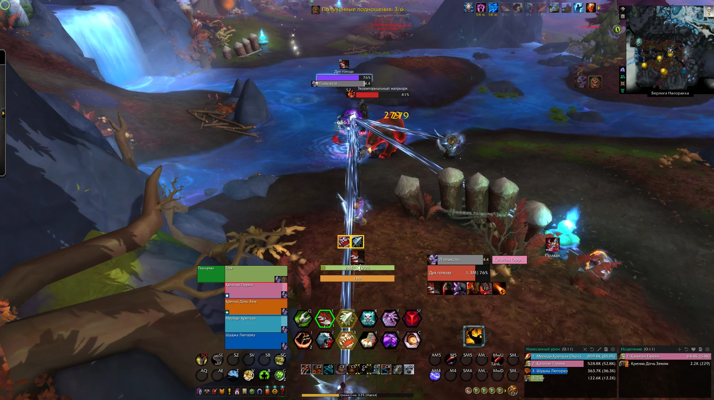

# WoW Profile

My World of Warcraft interface for retail 12.1 (Midnight), mostly for healing and Mythic+ keys. A compact layout with one combat cluster under the character.

## Files

| File | What it is |
|------|------------|
| [EllesmereUI-Compact-Keys.txt](EllesmereUI-Compact-Keys.txt) | EllesmereUI profile: unit frames, action bars, resource bars, chat, quest tracker and the rest of the screen |
| [Blizzard-EditMode-AI.txt](Blizzard-EditMode-AI.txt) | Blizzard Edit Mode layout: places the frames EllesmereUI does not replace |

## Addons

- **EllesmereUI** is required.
- [HoldToShow](https://github.com/SlivaNilow/HoldToShow): chat and the quest tracker are hidden in this profile, hold Ctrl to show them.
- [ComboGlow](https://github.com/SlivaNilow/ComboGlow): marks on the action bars and the glow on the resource bar.

## Import

Open a file, press **Raw** on GitHub and copy the whole line.

1. **EllesmereUI:** `/eui` → Profiles → Import.
2. **Blizzard UI:** Edit Mode → Layout → Import.
